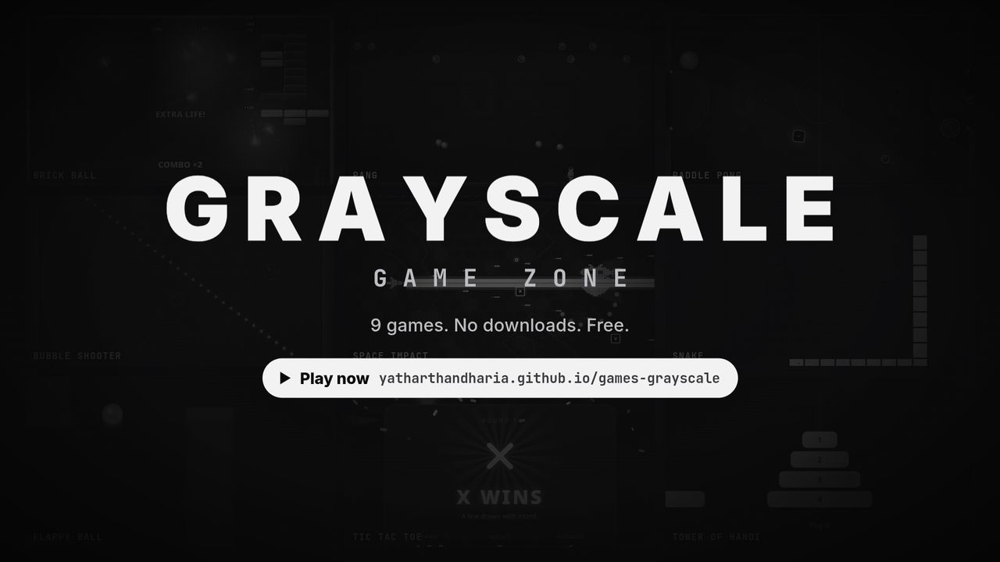

# 🎮 Grayscale Game Zone

> Nine arcade classics in one browser tab, styled in a modern dark grayscale theme. Free to play, no downloads.

**[🚀 Play Now](https://yatharthandharia.github.io/games-grayscale/)**

[](https://yatharthandharia.github.io/games-grayscale/media/brag.mp4)

*▶ Click the image to watch the 40-second gameplay trailer.*

---

## 🎯 Available Games

### 1. [⚪ Brick Ball](https://yatharthandharia.github.io/games-grayscale/brickball.html)

Arkanoid-style brick breaker: 10 stages of sealed steel formations you break into through a single narrow lock, layouts that change every run, a final boss, a hidden extra life on every stage, 9 power-ups, combos, animated themed backdrops, and keyboard or mouse controls

### 2. [🎈 Pang](https://yatharthandharia.github.io/games-grayscale/pang.html)

Harpoon-shooting arcade action: split and pop bouncing balls across 12 stages and a boss, with 9 power-ups, combos, and keyboard or mouse controls

### 3. [🏓 Paddle Pong](https://yatharthandharia.github.io/games-grayscale/paddlepong.html)

Air hockey duel: climb a tournament of 8 AI rivals, each with its own play style and special table (pegs, turbo lanes, black ice, twin pucks, sliding gate, orbiting bumpers), up to a final boss and an unlockable Pro circuit. Also has 6 power-ups, star ratings, local 2-player mode, and mouse, touch or keyboard controls

### 4. [🫧 Bubble Shooter](https://yatharthandharia.github.io/games-grayscale/bubbleshooter.html)

The one game in colour: match three or more to pop bubbles and cut the threads to drop whole bunches before the rows cross the line. Endless waves with changing formations, Bomb, Lightning, Rainbow and Fire powers, stone and ice hazards, combo multipliers, bank-shot bonuses, and mouse, touch or keyboard controls

### 5. [🐍 Snake](https://yatharthandharia.github.io/games-grayscale/snake.html)

The timeless snake game reimagined with modern controls and sleek visuals

### 6. [🐦 Flappy Ball](https://yatharthandharia.github.io/games-grayscale/flappyball.html)

Navigate through obstacles in this addictive side-scrolling adventure with precise one-button controls

### 7. [⌗ Tic Tac Toe](https://yatharthandharia.github.io/games-grayscale/tictactoe.html)

Strategic X's and O's with AI from Easy to Unbeatable, a local 2-player mode, and smooth animations

### 8. [🗼 Tower of Hanoi](https://yatharthandharia.github.io/games-grayscale/towerofhanoi.html)

Mind-bending puzzle game with an auto-solver and smooth disk movements

### 9. [🚀 Space Impact](https://yatharthandharia.github.io/games-grayscale/spaceimpact.html)

Side-scrolling shooter inspired by the classic Nokia game: 7 levels (deep space, asteroids, planet surface, caverns, alien hive, iron fortress, the core), each ending in a boss with its own attack patterns. Includes Missile, Laser Beam and Wall special weapons, gun upgrades, shields, chain multipliers, mission select, harder replay loops, and keyboard, mouse or touch controls

---

## 🏠 The Home Page

The [home page](https://yatharthandharia.github.io/games-grayscale/) is a single animated HTML file:

- 🎬 **Gameplay trailer** - a 40-second reel of all nine games, loaded only when you press play
- 🕹️ **Live previews** - every game card plays a tiny self-running demo of its game
- 🔎 **Filters** - Arcade, Puzzle & strategy, Boss fights, 2 players, Touch friendly
- ⌨️ **Shortcuts** - press `1`–`9` to jump straight into a game, or `R` for a random one
- 🎲 **Surprise me** - picks a random game for you
- ↩️ **Continue** - remembers the last game you played
- ✨ **Interactive effects** - scroll-driven parallax, click bursts, ripples, magnetic buttons, and floating shapes you can pop for combo points
- ♿ **Reduced motion** - honours your system's reduced-motion setting with still previews and no motion effects

---

## ✨ Features

- 🎨 **Dark Grayscale Theme** - Elegant monochrome design
- 📱 **Responsive Design** - Works on desktop, tablet and phone
- ⚡ **Smooth Animations** - Polished interactions and transitions
- 🎮 **Intuitive Controls** - Easy to learn, fun to master
- 🧠 **Smart AI** - Challenging gameplay with intelligent opponents
- 📦 **No Build Step** - Every game is a single self-contained HTML file

---

## 🚀 Quick Start

1. Visit the [main page](https://yatharthandharia.github.io/games-grayscale/)
2. Choose your favourite game (or hit **Surprise me**)
3. Start playing instantly - no downloads required!

To run it locally, clone the repo and serve the folder with any static server, for example:

```bash
python3 -m http.server 8000
# then open http://localhost:8000
```

---

**Made with 🩶 by [YatharthAndharia](https://in.linkedin.com/in/yatharth-andharia-b73506214)**

> Grayscale Game Zone - Where simplicity meets elegance
